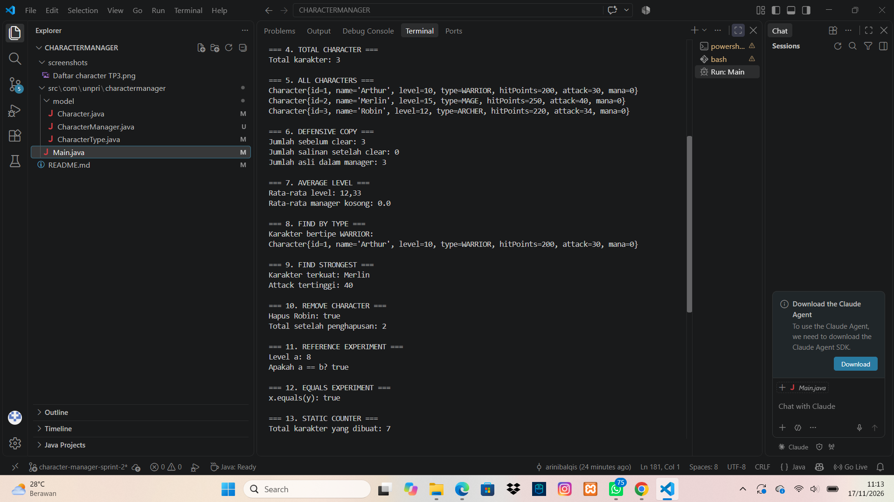

# Character Manager — TP3 & TP5 (Java Visual SIH-6406)

## TP3 — Sprint #1

Implementasi dasar Character Manager menggunakan Java OOP.
Fitur meliputi class Character, enum CharacterType,
constructor, encapsulation, mana, dan isAlive().

## TP5 — Sprint #2

### Fitur yang Diimplementasikan

1. equals() untuk membandingkan nama karakter.
2. addCharacter() untuk menambahkan karakter.
3. findByName() untuk mencari karakter.
4. removeCharacter() untuk menghapus karakter.
5. getTotalCharacters() untuk menghitung karakter.
6. getAllCharacters() menggunakan defensive copy.
7. getAverageLevel() untuk menghitung rata-rata level.
8. findByType() untuk mencari berdasarkan tipe.
9. findStrongest() untuk mencari karakter dengan attack tertinggi.

### Eksperimen Reference

Program membuktikan bahwa dua variabel dapat
mengarah ke objek yang sama.

Hasil:
- Level a: 8
- a == b: true

### Defensive Copy

Eksperimen clear() pada ArrayList hasil getAllCharacters()
tidak menghapus data asli dalam CharacterManager.

### Fitur Analitik Mandiri

findStrongest() digunakan untuk mencari karakter
dengan nilai attack paling tinggi.

### Screenshot Output TP5

### Google Docs — Analisis TP5

Nama: Arini Balqis

NIM: 253303621263

Link Google Docs:
https://docs.google.com/document/d/15CF2SieaXuLtPEREpwlK6MXO5XlRL1l3rD_S1a2Jryw/edit?usp=sharing 

## Identitas

Nama: Arini Balqis

NIM: 253303621263

Kelas: 3 Pagi B

Mata Kuliah: Java Visual (SIH-6406)
